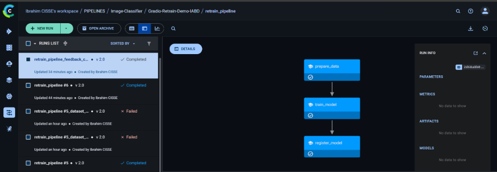
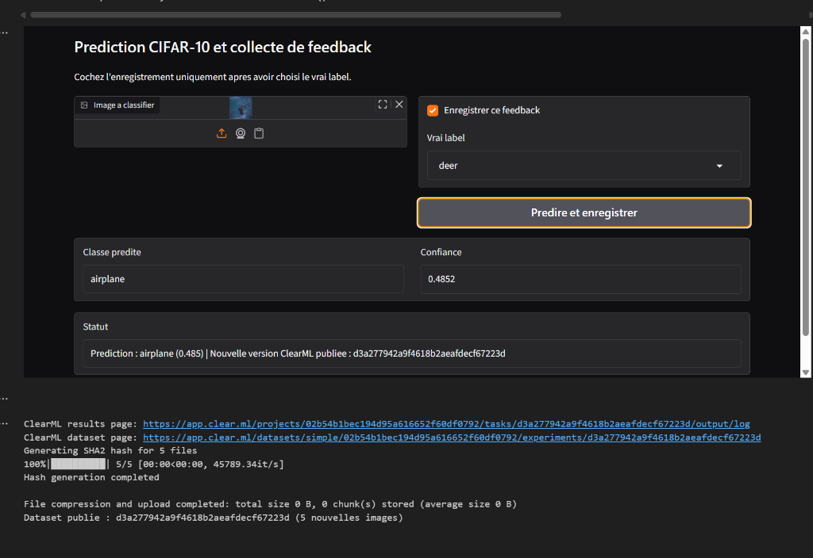
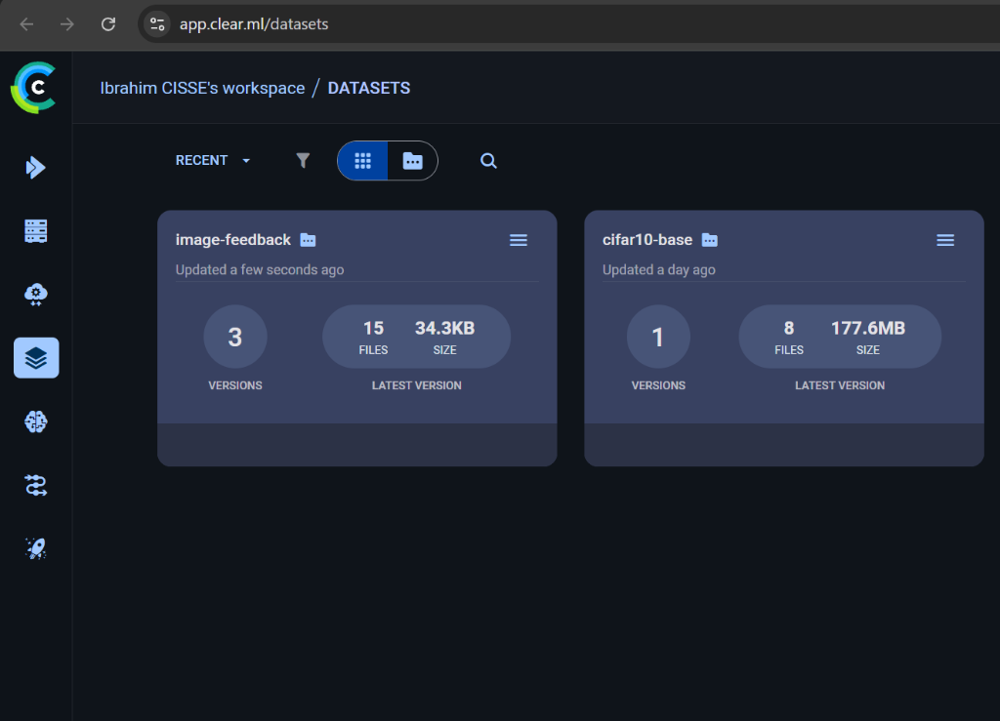
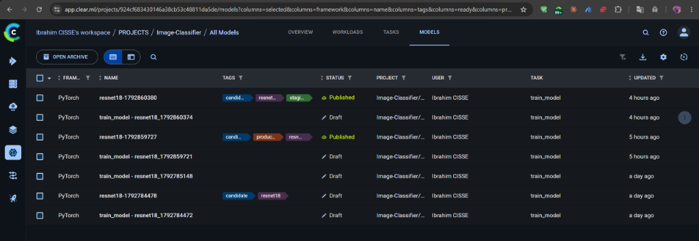

# MLOps niveau 1 : réentraînement continu avec ClearML

Boucle MLOps fermée pour un classifieur d'images CIFAR-10 (ResNet-18, PyTorch).

Des utilisateurs corrigent les prédictions dans une application Gradio. Leurs corrections deviennent une nouvelle version du jeu de données, et cette version déclenche automatiquement un pipeline de réentraînement. Le nouveau modèle n'est promu en production que s'il fait mieux que le modèle actuel.

Projet réalisé dans le cadre du module MLOps (S9) de l'option IA & Big Data à l'EIGSI Casablanca, 2026. Le rapport complet est dans [`report/Rapport_TP2_MLOps_Ibrahim_CISSE.pdf`](report/Rapport_TP2_MLOps_Ibrahim_CISSE.pdf).



## Fonctionnement

```
 Utilisateur ──► App Gradio (NB_A) ──► lot de 5 corrections ──► dataset "image-feedback" v(n+1)
                                                                        │
                                                                        ▼
 Model Registry ◄── register_model ◄── train_model ◄── prepare_data ◄── Watcher (NB_B)
 (production / staging)          pipeline "retrain_pipeline" (NB_C)
```

1. **Inférence et feedback** (`NB_A_infer_feedback`) : l'application Gradio classe une image avec le modèle de production. L'utilisateur peut corriger l'étiquette, choisie dans une liste fermée des 10 classes.
2. **Versioning des données** : à chaque lot de 5 corrections, une nouvelle version du dataset `image-feedback` est publiée dans ClearML. Elle hérite de la version précédente (lignée) et porte le tag `auto-feedback`.
3. **Déclenchement** (`NB_B_setup_trigger`) : un watcher surveille les versions publiées. À chaque nouvelle version, il clone le pipeline et lui transmet l'**identifiant exact** du dataset, ce qui garantit la reproductibilité.
4. **Pipeline de réentraînement** (`NB_C_pipeline`, `pipeline_logic.py`) : un graphe en 3 étapes.
   - `prepare_data` récupère le feedback.
   - `train_model` entraîne le ResNet-18 sur CIFAR-10 et le feedback.
   - `register_model` évalue le modèle sur le jeu de test.
5. **Quality gate** : le modèle candidat n'est tagué `production` que s'il dépasse la précision du modèle en service d'au moins 0,2 point. Sinon, il reste en `staging`.

## Architecture d'exécution

Deux agents ClearML tournent dans des conteneurs Docker (`docker-compose.yml`), chacun sur sa propre file d'attente :

| Agent | File | Rôle |
| --- | --- | --- |
| `agent-default` (`NB_Agent1`) | `default` | Exécute les étapes lourdes : préparation des données, entraînement, évaluation. |
| `agent-controller` (`NB_Agent2`) | `controller` | Orchestre le graphe du pipeline. |

Séparer les deux files évite qu'un long entraînement bloque le contrôleur. L'image des agents (`Dockerfile.agent`) est basée sur Python 3.11, avec PyTorch, torchvision et ClearML préinstallés.

## Résultats

Exécution réelle documentée dans le rapport :

- Dataset de base `cifar10-base` : 50 000 images. Dataset `image-feedback` : 3 versions successives, 15 images corrigées.
- Pipeline déclenché automatiquement par le watcher. Les 3 étapes se terminent avec succès.
- Réentraînement : la précision de validation passe de 54,2 % à 63,8 % en 3 époques.
- Quality gate : le modèle réentraîné (63,8 %) est resté en `staging`. Le modèle de production (68,4 %) n'a pas été remplacé.

| Feedback dans Gradio | Versions du dataset | Model Registry |
| --- | --- | --- |
|  |  |  |

## Corrections apportées au sujet initial

Le rapport analyse trois défauts du code fourni et leurs corrections :

1. **Course entre le watcher et le pipeline** : le pipeline prenait « la dernière version » du dataset au lieu de celle qui l'avait déclenché. Il reçoit maintenant l'identifiant exact du dataset.
2. **Saisie libre de l'étiquette dans Gradio** : une étiquette inexistante faisait échouer l'entraînement. La saisie se fait maintenant par une liste fermée, et le lot local est archivé après chaque publication pour ne pas être republié.
3. **Promotion aveugle en production** : tout nouveau modèle remplaçait l'ancien. Une quality gate compare maintenant le candidat au modèle en service.

## Lancer le projet

Prérequis : Docker Desktop, Python 3.11 et un compte gratuit [ClearML](https://app.clear.ml).

1. Configurer les identifiants :

   ```bash
   cp .env.example .env                    # renseigner les clés ClearML
   cp clearml.conf.example clearml.conf
   ```

2. Construire l'image des agents et les démarrer :

   ```bash
   docker build -f Dockerfile.agent -t clearml-agent-local:py311 .
   docker compose up -d
   docker compose logs -f
   ```

3. Installer les dépendances et ouvrir les notebooks dans cet ordre :

   ```bash
   pip install -r requirements.txt
   ```

   `NB_Agent1` → `NB_Agent2` → `NB_C_pipeline` → `NB_B_setup_trigger` → `NB_A_infer_feedback`

4. Après le premier lancement de `NB_C_pipeline`, copier l'identifiant de la tâche `retrain_pipeline` dans `PIPELINE_TASK_ID` (fichier `.env`) avant de lancer le watcher.

Des images de test sont fournies dans `sample_images/`, une par classe.

## Structure

```
├── NB_A_infer_feedback.ipynb   # App Gradio : inférence + collecte du feedback
├── NB_B_setup_trigger.ipynb    # Watcher : détecte les nouvelles versions du dataset
├── NB_C_pipeline.ipynb         # Définition et premier lancement du pipeline
├── NB_Agent1.ipynb             # Agent ClearML, file "default"
├── NB_Agent2.ipynb             # Agent ClearML, file "controller"
├── pipeline_logic.py           # Étapes du pipeline (prepare_data, train_model, register_model)
├── Dockerfile.agent            # Image des agents (Python 3.11, PyTorch, ClearML)
├── docker-compose.yml          # Les deux agents
├── sample_images/              # Images CIFAR-10 de test
├── docs/images/                # Captures ClearML
└── report/                     # Rapport du TP (PDF)
```

## Stack

Python · PyTorch / torchvision · ClearML (datasets, pipelines, agents, Model Registry) · Gradio · Docker / Docker Compose

---

**Ibrahim CISSE**, élève-ingénieur IA & Big Data, EIGSI Casablanca · [LinkedIn](https://www.linkedin.com/in/cisseamadouibrahim/) · [GitHub](https://github.com/ibralearn)
